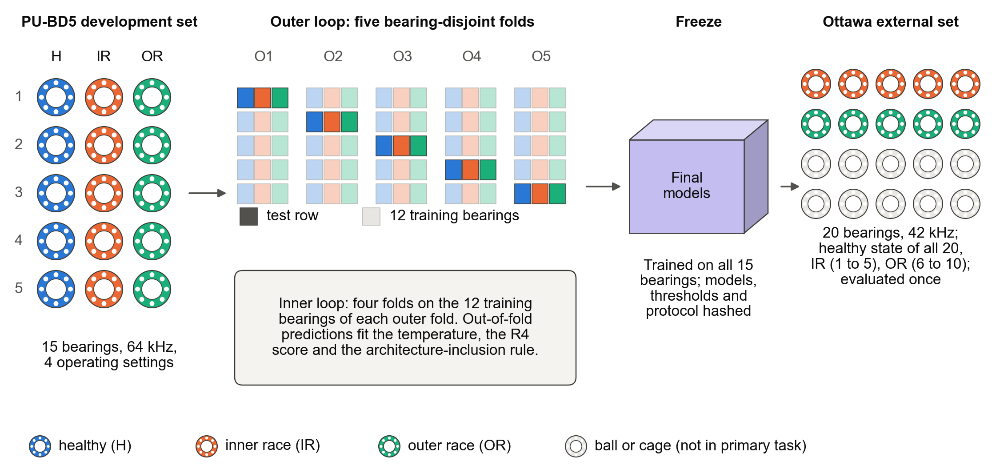
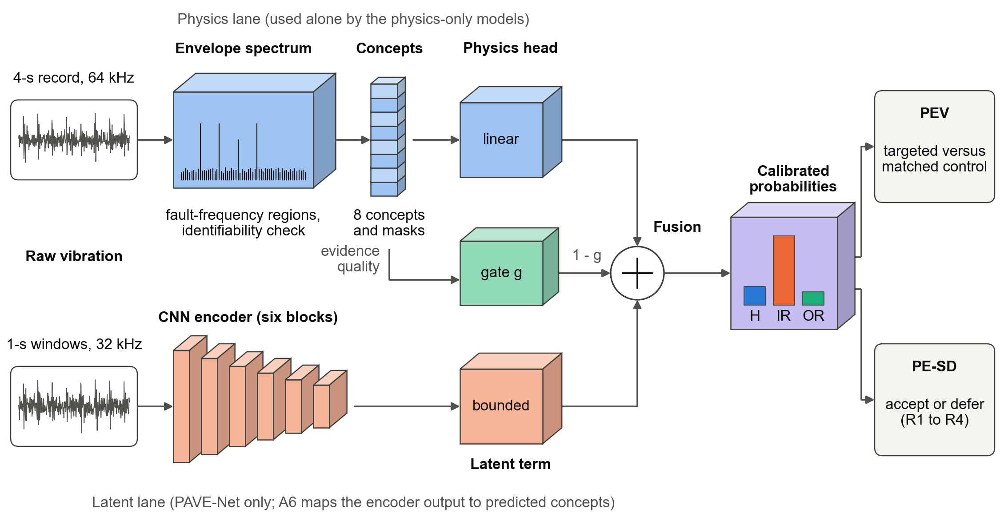
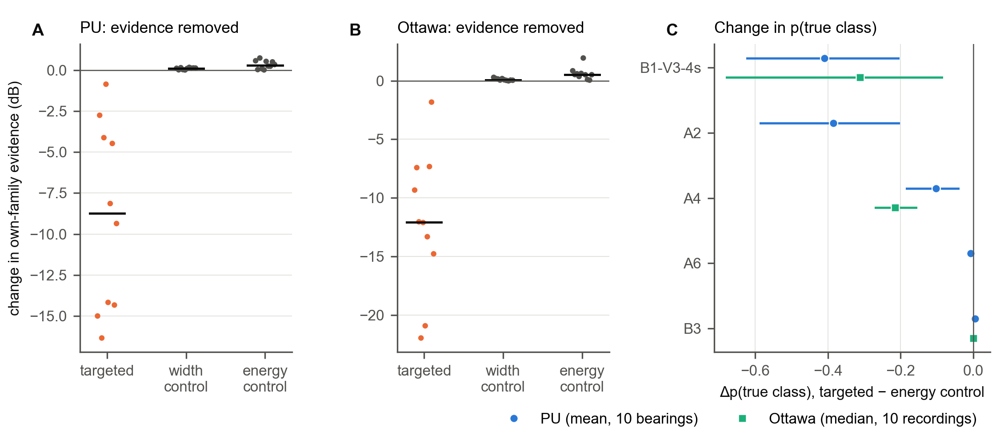
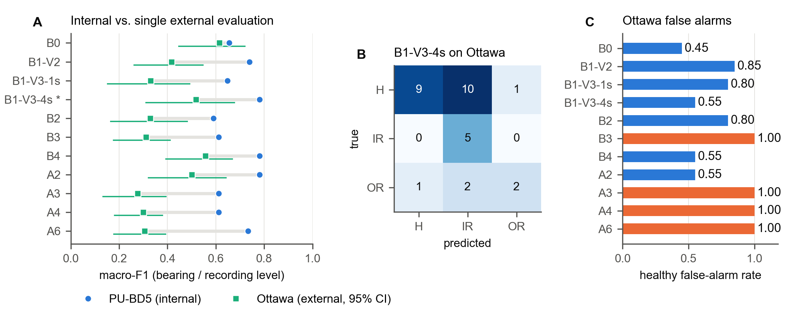

# Physically grounded vibration evidence for verifiable bearing fault diagnosis

Code, protocols and results for the manuscript

> **Physically grounded vibration evidence for verifiable bearing fault diagnosis on unseen bearings.**
> Cao-Phuc Ha and Phu-Nguyen Le. Manuscript prepared for PLOS ONE.

## Overview

The study asks whether physically meaningful vibration evidence supports reliable and verifiable diagnosis of healthy,
inner-race and outer-race bearing states when the physical bearing is the unit of analysis.

- **Development set:** 15 Paderborn bearings (PU-BD5), evaluated by nested bearing-disjoint cross-validation (five outer
  folds, four inner folds).
- **Physics concepts:** eight envelope-spectrum concepts with explicit identifiability checks against shaft harmonics.
- **Models compared:** physics-only models, an unconstrained 1-D CNN, a concept bottleneck model and PAVE-Net, a
  physics-anchored fusion model with an evidence-gated latent branch.
- **Verification:** targeted envelope-domain interventions with width- and energy-matched controls test whether a model
  depends on the evidence named by its explanation.
- **External validation:** the frozen final models were evaluated once on 20 University of Ottawa bearings.

Every analysis was specified in a versioned internal protocol whose SHA-256 hash was recorded before the analysis was
run (`docs/RESEARCH_PROTOCOL_V2*.md`, `docs/EXTERNAL_VALIDATION_PROTOCOL_V1.md`, `docs/PROTOCOL_FREEZE*.txt`).

## Study design



*Development on 15 Paderborn bearings with five bearing-disjoint outer folds and four inner folds, followed by a single
evaluation of the frozen final models on 20 Ottawa bearings.*

## Model architecture



*The physics lane computes envelope concepts from a 4-s record and feeds a linear head. The latent lane encodes 1-s
windows with a CNN and adds a bounded term weighted by an evidence-quality gate. The physics-only models use the physics
lane alone.*

## Main results

| | PU-BD5 (15 bearings, internal) | Ottawa (30 recordings, external, evaluated once) |
|---|---|---|
| Final model | B1-V3-4s (logistic model on 4-s concepts) | same, frozen |
| Macro-F1 (95% CI) | 0.780 (0.56 to 0.93) | 0.518 (0.31 to 0.68) |
| Balanced accuracy | 0.800 | 0.617 |
| Healthy false-alarm rate | 0.00 | 0.55 |

- **Effect of evidence suppression:** targeted suppression of the named fault-frequency bands, relative to the
  energy-matched control, lowered the true-class probability of B1-V3-4s by 0.41 (95% CI 0.21 to 0.62) in all 10 faulty
  PU bearings. The CNN showed no measurable change.
- **Statistical support:** no pairwise model difference on PU-BD5 was statistically supported.



*Change in the fault-family evidence and in the true-class probability under targeted suppression of the named
fault-frequency bands, relative to width- and energy-matched controls.*



*Internal and external macro-F1, confusion matrix of the primary model on Ottawa, and healthy false-alarm rates.*

## Repository structure

```
pave/                  Python package: data readers, signal processing, physics concepts, models, training,
                       calibration, interventions, evaluation
scripts/               audits, feature extraction, experiments, external evaluation, figures, tables, manuscript build
tests/                 automated tests (110), including leakage checks between training and test bearings
03_MANIFESTS/          file inventories with SHA-256 hashes, bearing metadata and frozen split manifests
docs/                  protocols, freeze records, phase reports, decision log, audit reports
results/               result tables (CSV/JSON) from which all figures and tables are generated
manuscript/            manuscript source (pavenet_main.tex), compiled PDFs, supporting tables
```

## Data

The vibration datasets are public third-party datasets and are not redistributed in this repository.

| Dataset | Use | Source |
|---|---|---|
| Paderborn University KAt-DataCenter bearing dataset | development | https://groups.uni-paderborn.de/kat/BearingDataCenter/ |
| University of Ottawa UORED-VAFCLS, version 5 | external validation | https://doi.org/10.17632/y2px5tg92h.5 |
| KAIST rotating machine dataset | data audit only | https://doi.org/10.17632/ztmf3m7h5x |

Place the downloaded files under `01_RAW_DATA/` as described in `REPRODUCE.md`. The SHA-256 hashes of the original files are listed in `03_MANIFESTS/`. The large derived arrays (`*.npy`, `*.npz`) and the model checkpoints are not
included; the scripts regenerate them.

## Reproduction

```bash
pip install -r requirements.txt     # Python 3.10
python -m pytest -q                 # 110 tests
```

The full sequence of commands, from the data audit to the figures and the manuscript, is given in `REPRODUCE.md`. The
experiments were run on Windows 11 with an NVIDIA RTX 3060 Laptop GPU (6 GB).

The Ottawa evaluation script is locked (`results/phase4/EVALUATED.lock`) and refuses a second run. This lock is part of
the study design.

## License

The code in this repository is released under the [MIT License](LICENSE). The third-party datasets are not part of
this repository and remain under the terms of their original providers.

## Contact

For questions about the code, the data processing or the reproduction of the results, please contact:

**Cao-Phuc Ha**  
Department of Artificial Intelligence, FPT University, Ho Chi Minh City, Vietnam  
Email: caophucai@gmail.com  
ORCID: [0009-0004-7024-5166](https://orcid.org/0009-0004-7024-5166)

**Phu-Nguyen Le** (corresponding author of the manuscript)  
Faculty of Electrical and Electronics Engineering, Vietnam Aerospace University, Ho Chi Minh City, Vietnam  
Email: nguyenlp@vaa.edu.vn  
ORCID: [0000-0001-6773-6336](https://orcid.org/0000-0001-6773-6336)
